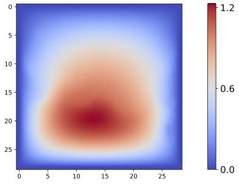
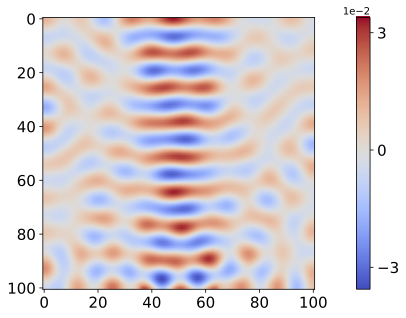
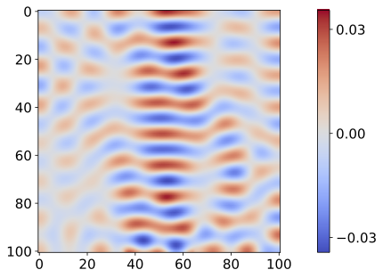
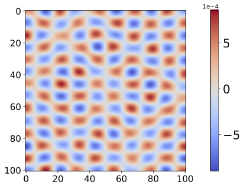

# Cauchy Random Features for Operator Learning in Sobolev Space

## Overview
This Github repository contains the numerical implementations accompanying the paper **Cauchy Random Features for Operator Learning in Sobolev Space**. The numerical experiments evaluate the performance of proposed method on several operator learning benchmarks and provide numerical verification of theory. 

## Preprint
A detailed description of the model, methodology, and numerical results is available in the following preprint:

- Title: **Cauchy Random Features for Operator Learning in Sobolev Space**
- Author: Chunyang Liao, Deanna Needell, Hayden Schaeffer
- Preprint: https://arxiv.org/abs/2503.00300

#### Citation
```bibtex
@article{liao2025cauchy,
  title={Cauchy random features for operator learning in sobolev space},
  author={Liao, Chunyang and Needell, Deanna and Schaeffer, Hayden},
  journal={arXiv preprint arXiv:2503.00300},
  year={2025}
}
```

## Numerical Experiments

Contains code to generate random features

- [`Random Features/`](./RF/) — Random Features Generation

numerical experiments for several operator learning benchmarks, including:

- [`Advection/`](./Advection/) — Advection Equation with three different types of initial conditions
- [`Burgers' Equation/`](./Burgers/) — Burgers' Equation
- [`Darcy Flow/`](./Darcy/) — Darcy Flow
- [`Helmholtz/`](./Helmholtz/) — Helmholtz Equation
- [`Navier Stokes Equation/`](./Navier_Stokes/) — Navier-Stokes Equation
- [`Structural Mechanics/`](./Structural_Mechanics/) — Structural Mechanics

#### Darcy Flow

<p align="center">
  
  
  
</p>

<p align="center">
  <strong>Figure 1. </strong> Numerical results of Darcy Flow. From left to right: true output, random feature prediction, point-wise error.
</p>

#### Darcy Flow

<p align="center">
  
  
  
</p>

<p align="center">
  <strong>Figure 1. </strong> Numerical results of Darcy Flow. From left to right: true output, random feature prediction, point-wise error.
</p>

#### Darcy Flow

<p align="center">
  
  
  
</p>

<p align="center">
  <strong>Figure 2. </strong> Numerical results of Helmholtz. From left to right: true output, random feature prediction, point-wise error.
</p>
